# Hybrid-Controlled Seed-Dispensing Robot

A small autonomous robot that drives around a field, avoids obstacles with a laser scanner, and drops seeds from a 3D printed pot every two seconds. It runs on a TurtleBot3 Burger with ROS2 for the driving and an Arduino Uno for the seed gate and the status lights.

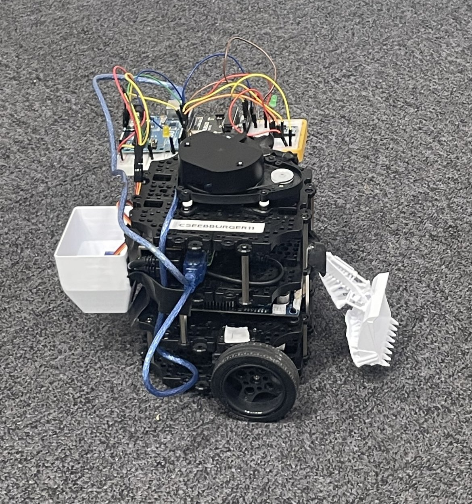

## What it does

The robot has three parts that work at the same time.

- It drives forward on its own and uses the 360 degree laser distance sensor to spot anything closer than 0.2 m. If something is in the way it stops, turns on the spot away from the nearer obstacle until the path is clear, then carries on. It can also be driven by hand from the keyboard.
- A servo inside the seed pot opens a gate to 65 degrees for 300 ms so a few seeds fall out, then closes it for 1.7 s. That gives one drop every 2 seconds.
- An IMU on the Arduino senses when the robot speeds up forwards or backwards. A green LED comes on when it moves forward, a red LED when it reverses, and a yellow LED blinks every half second the whole time so people nearby know the robot is active.

I also mapped a simulated field with the robot in Gazebo using SLAM (Cartographer and RViz). The full map took about 3 minutes to build.

## My role

This was a solo build between October 2023 and April 2024. I did all of it:

- Chose the idea, researched seed planting methods and picked the hardware.
- Designed the seed pot in TinkerCAD, then remodelled it in SolidWorks and 3D printed it.
- Wrote the Arduino code for the servo, the IMU and the LEDs, and wired the circuit on a breadboard.
- Wrote the ROS2 nodes in Python for the square path test and the laser based obstacle avoidance.
- Set up the simulation and SLAM, then tested everything on the real robot.
- Ran the project with Agile sprints in Jira and kept the code in GitLab.

## How it works

### System overview

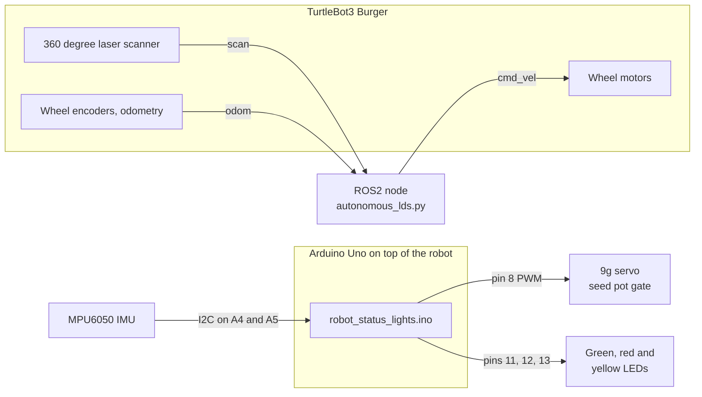

The ROS2 side and the Arduino side run independently. The ROS2 node drives the robot and avoids obstacles, while the Arduino drops seeds on a fixed timer and shows the robot's motion with the LEDs.

### Wiring (Arduino Uno)

| Part | Part pin | Arduino pin |
| --- | --- | --- |
| MPU6050 IMU | VCC | 5V |
| MPU6050 IMU | GND | GND |
| MPU6050 IMU | SDA | A4 (I2C data) |
| MPU6050 IMU | SCL | A5 (I2C clock) |
| 9g servo | Signal | Pin 8 |
| 9g servo | Power | 5V |
| 9g servo | Ground | GND |
| Green LED | Anode | Pin 11 |
| Red LED | Anode | Pin 12 |
| Yellow LED | Anode | Pin 13 |
| All three LEDs | Cathode | GND |
| Arduino Uno | Power | USB while testing, TurtleBot supply when fitted |

### Driving and obstacle avoidance (ROS2)

The TurtleBot3 Burger runs ROS2. My node subscribes to the laser scan and odometry topics and publishes velocity commands every 0.3 s.

- Three laser readings are checked each cycle: straight ahead, and 30 degrees off to each side. Each beam is found from the scan's own angle_min and angle_increment, so the node works whatever resolution the scanner runs at.
- If any of the three is under 0.2 m the robot stops moving forward and turns on the spot away from the nearer obstacle: right if it is on the left, left if it is on the right. It turns at 0.7 rad/s for a side obstacle and 0.5 rad/s for one straight ahead, where it turns away from whichever side reads closer. Otherwise it drives forward at 0.05 m/s.
- A beam with nothing inside the scanner's maximum range counts as clear, so open space ahead never stops the robot. Readings that are NaN or below the minimum range are ignored. If the straight ahead reading is unusable, the robot never drives forward but turns slowly on the spot until it gets a valid reading, and if all three are unusable it stays stopped until good readings come in.
- Safe stop: if no new laser scan has arrived for one second, the robot stops and waits until scans come back, so it never drives blind.
- The odometry comes from the wheel encoders, which give 4096 pulses per turn, so each pulse is 0.088 degrees of wheel movement.

The node also has a PID controller class (gains 1.0, 0.1 and 0.01). It runs every cycle and is ready to drive the forward speed, which I kept fixed during testing.

My first driving test was a 1 m square using odometry only. Each corner adds up how far the robot has turned since that corner started and stops at 90 degrees, so no corner can be cut short or skipped. I wrote it as its own node, `square_path.py`.

### Seed dispensing (Arduino)

A 9g micro servo sits in the bottom of the pot and works a small gate. The Arduino moves it from 0 to 65 degrees, waits 300 ms, then moves it back and waits 1700 ms. The servo runs off the Arduino's 5V pin. The Arduino itself was powered over USB while testing and from the TurtleBot's supply when fitted.

### Status lights (Arduino)

An MPU6050 IMU on the breadboard reads acceleration on three axes over I2C. The Y axis points along the robot. When the raw Y reading goes above 3000 the green LED comes on, and below minus 3000 the red one does. The yellow LED blinks on and off every 500 ms on its own timer. The servo gate and the yellow LED both run on millis() timers rather than delay(), so the gate really opens every 2 seconds, the LED keeps its own rhythm, and the IMU is read on every pass of the loop.

One thing changed from my first design. I started with two servos and six LEDs, and cut it down to one servo and three LEDs to save the TurtleBot's battery.

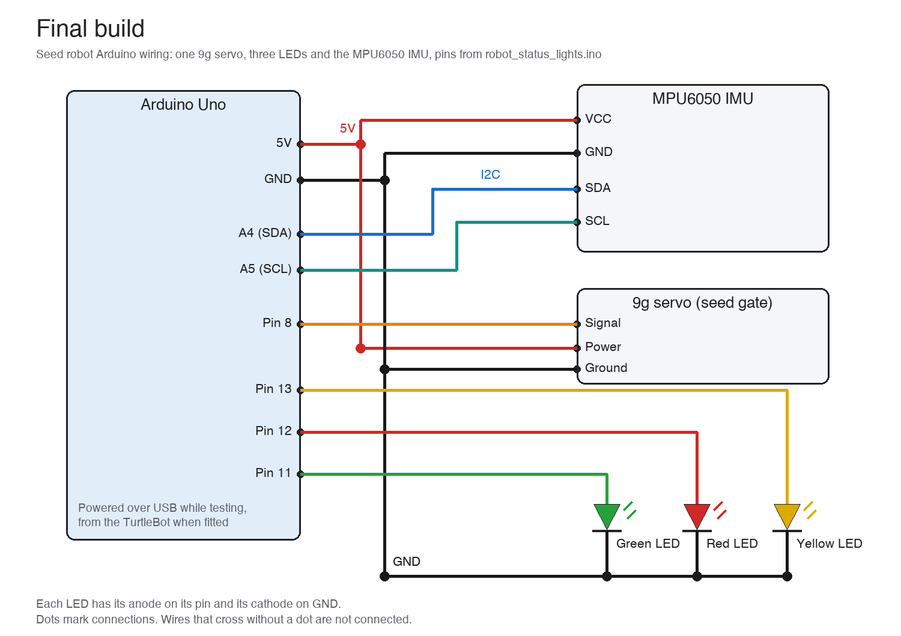

*Final build: one servo, three LEDs and the MPU6050, drawn from the pins in robot_status_lights.ino.*

I ran the LEDs without series resistors during testing, because 220 ohm resistors made them too dim to see across the lab. For a permanent build I would fit lower value resistors to protect the Arduino pins.

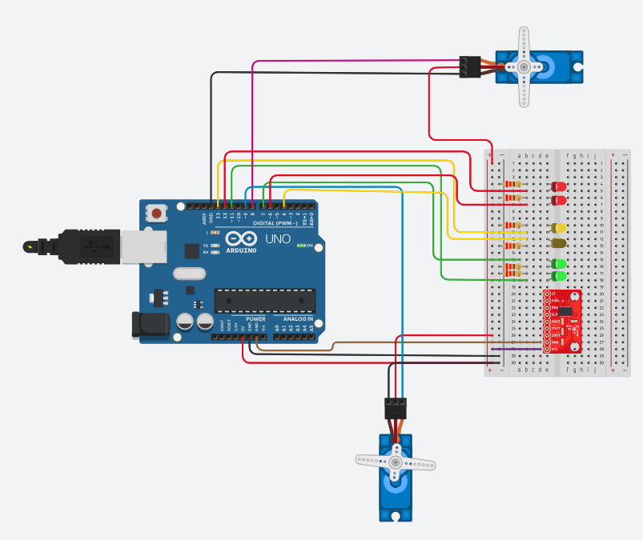

*My first circuit in TinkerCAD, with two servos and six LEDs, before I cut it down.*

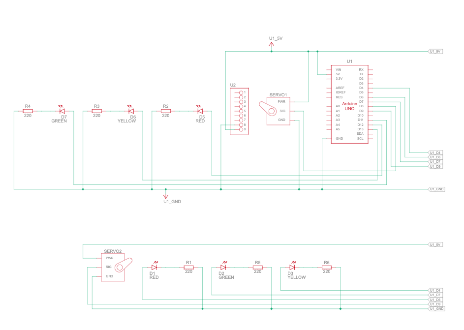

*The schematic for that first design, generated from the TinkerCAD circuit.*

### The seed pot (CAD)

The pot is two shapes joined together: a box on top, 70 by 55 by 32.5 mm, and a tapered section underneath that narrows to 50.5 by 35.5 mm over 30 mm of height. That gives a total capacity of 207,865 cubic mm. Testing the first prototypes showed me the seeds needed a wider path through the opening, which is what led to the tapered shape and the servo gate.

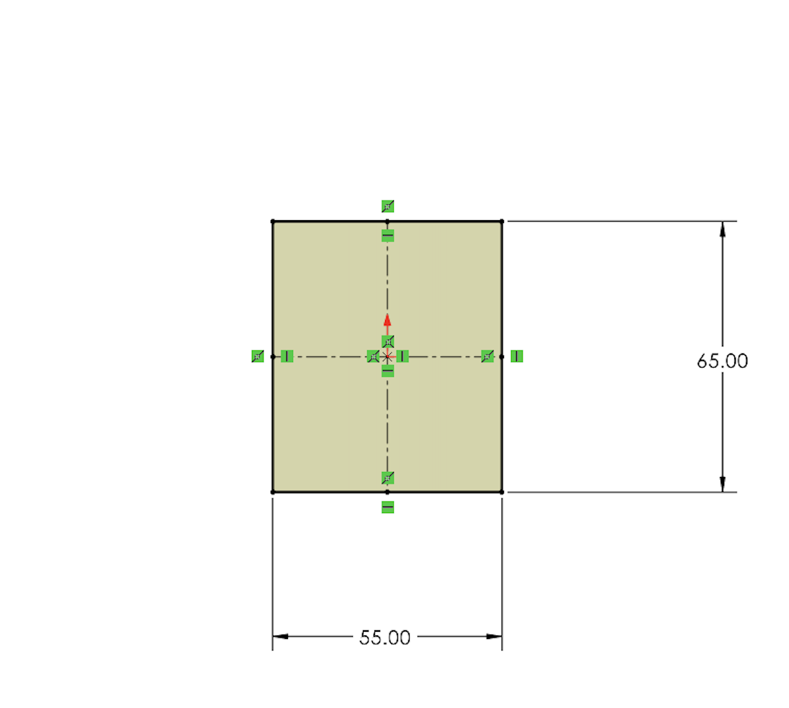

*Starting sketch for the pot in SolidWorks.*

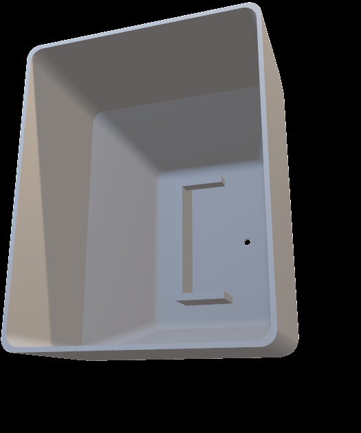

*Inside the pot, with the slot that holds the servo.*

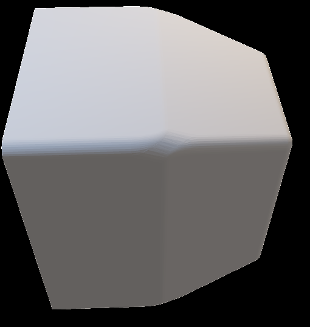

*The finished model, box on top and tapered section below.*

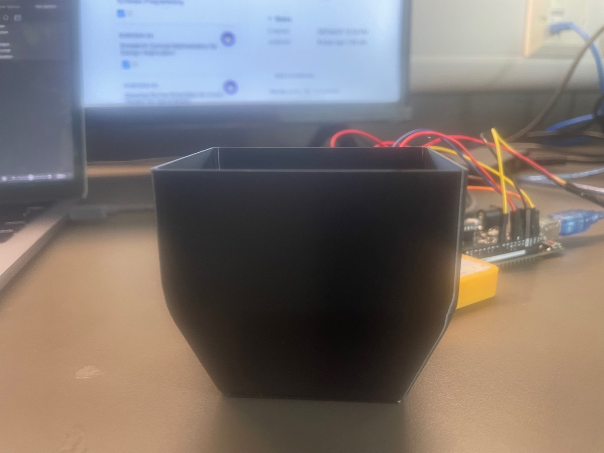

*The printed pot.*

### What I learned from testing

Odometry error got worse every time the robot rotated, and the encoders picked up some error from the floor surface. The laser scanner avoidance worked without any collisions in the runs I did. The things I would add next are a random walk so the robot covers a whole field instead of looping the same route, a Kalman filter on the odometry, and a docking station that refills the pot.

## Source code

The source code is private and available on request. Contact me at mkhodir77@gmail.com.

## What's in this repo

- `media/photos/` photos of the build.
- `media/cad/` the seed pot as an STL file.
- `media/figures/` the circuit, the CAD stages, the simulation and the LED readings.
- `docs/` my research notes on ROS2, Arduino, IMUs, conical shapes and farming methods.
- `media/demo/` the demo recordings, GIFs to watch here and one MP4 with captions.

## Demo

### The real robot

**Obstacle avoidance on the real TurtleBot.** The node driving the robot on its own past cardboard tubes, played at 2x.

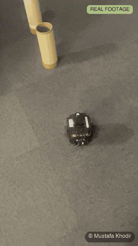

**Seed gate servo and status lights.** The 9g servo working the gate with the LEDs running on the breadboard.

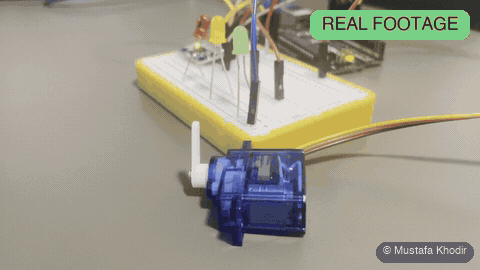

**First gate prototype.** An early cardboard mock up of the gate, turned by the servo, before the printed pot.

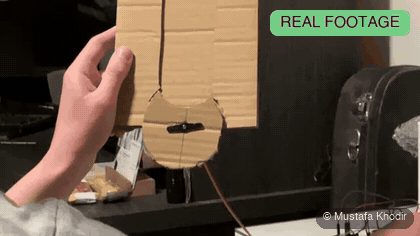

**Gazebo run.** The robot driving itself around the TurtleBot3 world in Gazebo, played at 8x.

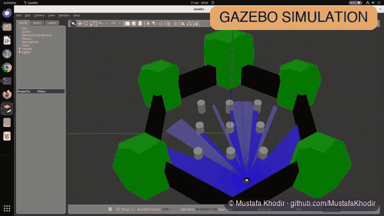

### Simulations of my code

**Obstacle avoidance (simulation).** autonomous_lds.py running unchanged in a 2D copy of the TurtleBot3 world, five minutes at 8x speed with no collisions. This is a 2D simulator with a laser model, not Gazebo.

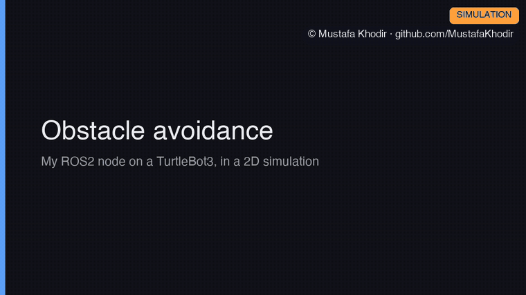

**Seed gate and status lights (simulation).** robot_status_lights.ino compiled for a PC with a simulated clock, showing the gate opening for 300 ms every 2 seconds and the yellow LED blinking every 500 ms. The IMU values are test inputs, not recorded data.

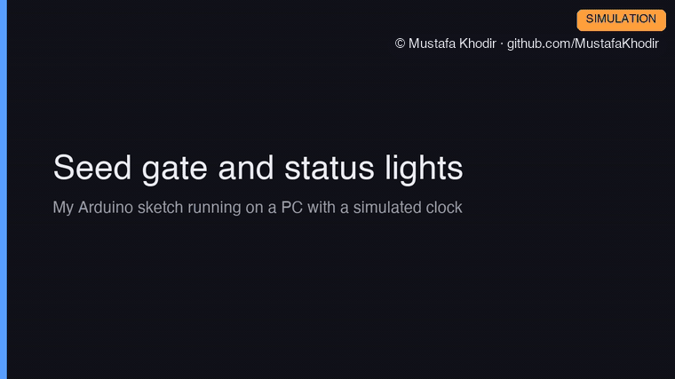

Both with captions:

https://github.com/user-attachments/assets/23180e2a-41df-4b9c-810b-e7237d245c8a

The same video is in the repo as [seed-robot-demo.mp4](media/demo/seed-robot-demo.mp4) (60 s). Background music in the MP4 is a warm plucked guitar track, synthesised from scratch for these demos and released as CC0.

### Photos

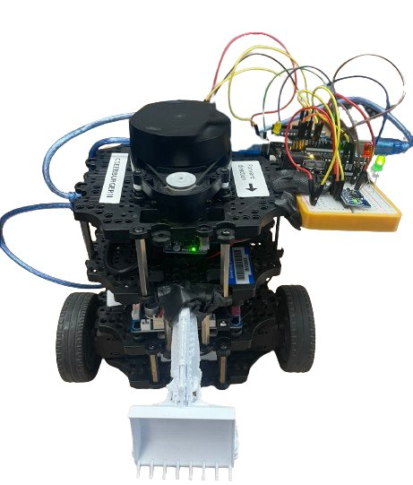 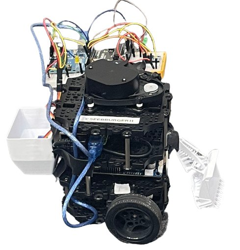 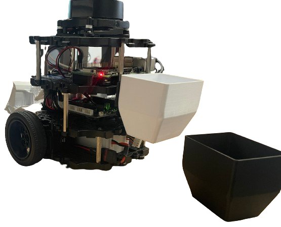

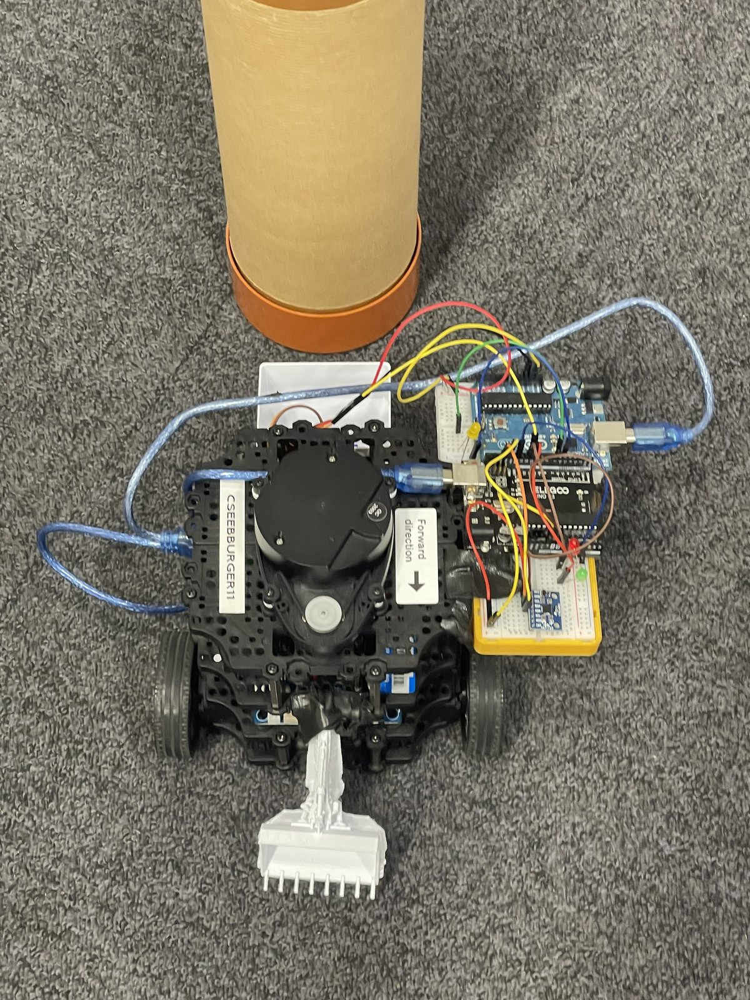 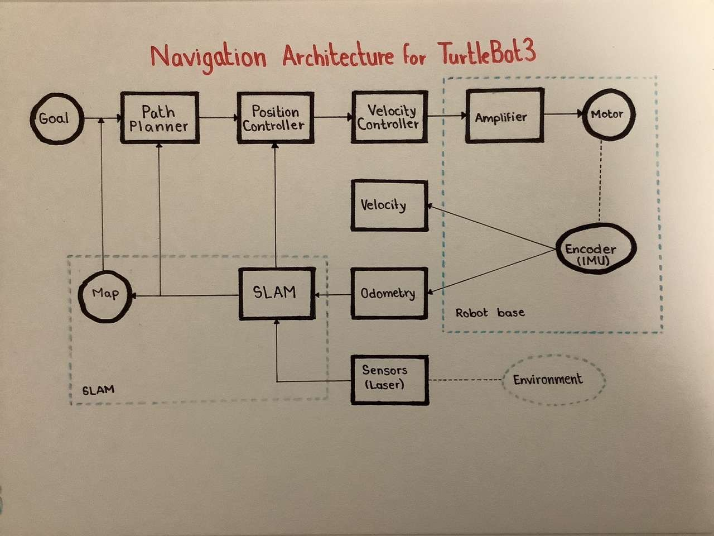 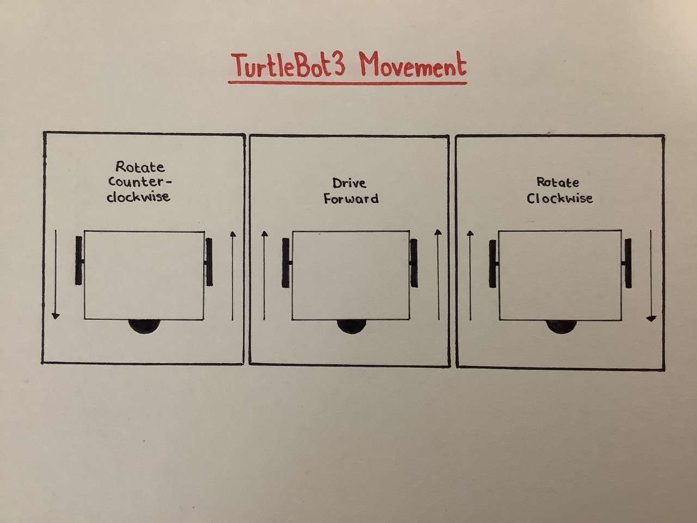

The seed pot is in `media/cad/seed-pot.stl`. GitHub opens it in a 3D viewer.

**Full capstone demo.** The 90 second demo video from the end of the project: manual navigation, autonomous navigation in simulation and in real life, the 3D printed parts and the electronics. Real footage.

https://github.com/user-attachments/assets/c37e527d-3f28-4c95-aecd-d630ef8a3281

The same video is in the repo as [seed-capstone-demo.mp4](media/demo/seed-capstone-demo.mp4) (90 s).

The full project report is available on request.

Copyright 2026 Mustafa Khodir. All rights reserved.
