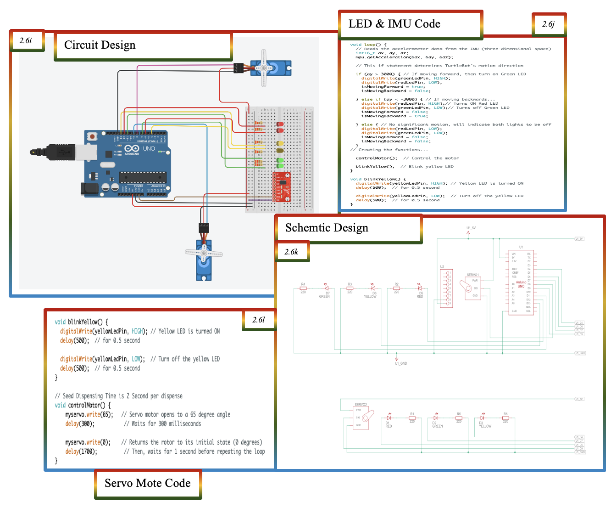
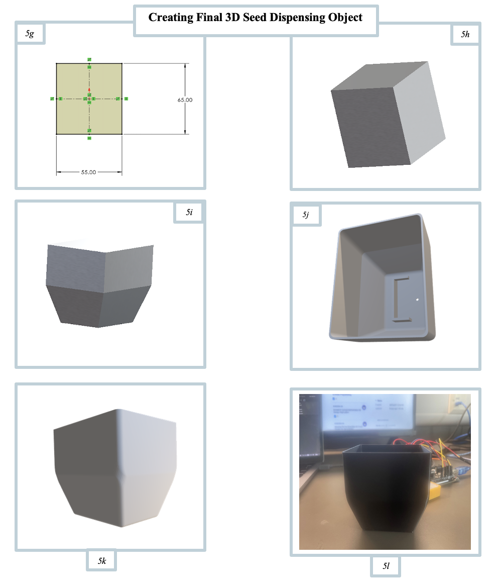

# Hybrid-Controlled Seed-Dispensing Robot

A small autonomous robot that drives around a field, avoids obstacles with a laser scanner, and drops seeds from a 3D printed pot every two seconds. It runs on a TurtleBot3 Burger with ROS2 for the driving and an Arduino Uno for the seed gate and the status lights.


## What it does

The robot has three parts that work at the same time.

- It drives forward on its own and uses the 360 degree laser distance sensor to spot anything closer than 0.2 m. If something is in the way it stops, turns on the spot until the path is clear, then carries on. It can also be driven by hand from the keyboard.
- A servo inside the seed pot opens a gate to 65 degrees for 300 ms so a few seeds fall out, then closes it for 1.7 s. That gives one drop every 2 seconds while the robot is moving.
- An IMU on the Arduino watches which way the robot is moving. A green LED comes on when it moves forward, a red LED when it reverses, and a yellow LED blinks every half second the whole time so people nearby know the robot is active.

I also mapped a simulated field with the robot in Gazebo using SLAM (Cartographer and RViz). The full map took about 3 minutes to build.

## My role

This was a solo build between October 2023 and April 2024. I did all of it:

- Chose the idea, researched seed planting methods and picked the hardware.
- Designed the seed pot in TinkerCAD, then remodelled it in SolidWorks and 3D printed it.
- Wrote the Arduino code for the servo, the IMU and the LEDs, and wired the circuit on a breadboard.
- Wrote the ROS2 nodes in Python for the square path test and the laser based obstacle avoidance.
- Set up the simulation and SLAM, then tested everything on the real robot.
- Ran the project with Agile sprints in Jira and kept the code in GitLab.

## How it works

### Driving and obstacle avoidance (ROS2)

The TurtleBot3 Burger runs ROS2. My node subscribes to the laser scan and odometry topics and publishes velocity commands every 0.3 s.

- Three laser readings are checked each cycle: straight ahead, and 30 degrees off to each side.
- If any of them is under 0.2 m the robot stops moving forward and turns on the spot (0.5 rad/s for straight ahead, 0.7 rad/s for the sides).
- Otherwise it drives forward at 0.05 m/s.
- The odometry comes from the wheel encoders, which give 4096 pulses per turn, so each pulse is 0.088 degrees of wheel movement.

The node also has a PID controller class (gains 1.0, 0.1 and 0.01). It runs every cycle and is ready to drive the forward speed, which I kept fixed during testing.

My first driving test was a 1 m square using odometry only. That code is in the repo too as `square_path.py`.

### Seed dispensing (Arduino)

A 9g micro servo sits in the bottom of the pot and works a small gate. The Arduino moves it from 0 to 65 degrees, waits 300 ms, then moves it back and waits 1700 ms. The servo runs off the Arduino's 5V pin. The Arduino itself was powered over USB while testing and from the TurtleBot's supply when fitted.

### Status lights (Arduino)

An MPU6050 IMU on the breadboard reads acceleration on three axes over I2C. The Y axis points along the robot. When the raw Y reading goes above 3000 the green LED comes on, and below minus 3000 the red one does. I picked 3000 after watching the readings in the Serial Plotter while pushing the robot. The yellow LED blinks on and off every 500 ms independently.

One thing changed from my first design. I started with two servos and six LEDs, and cut it down to one servo and three LEDs to save the TurtleBot's battery.



### The seed pot (CAD)

The pot is two shapes joined together: a box on top, 70 by 55 by 32.5 mm, and a tapered section underneath that narrows to 50.5 by 35.5 mm over 30 mm of height. That gives a total capacity of 207,865 cubic mm. Testing the first prototypes showed me the seeds needed a wider path through the opening, which is what led to the tapered shape and the servo gate.



### What I learned from testing

Odometry error got worse every time the robot rotated, and the encoders picked up some error from the floor surface. The laser scanner avoidance worked without any collisions in the runs I did. The things I would add next are a random walk so the robot covers a whole field instead of looping the same route, a Kalman filter on the odometry, and a docking station that refills the pot.

## How to run it

### Arduino

1. Open one of the sketches in the Arduino IDE. `robot_status_lights` is the final one. `seed_dispenser` and `seed_dispenser_led` are the two earlier servo only versions.
2. Install the MPU6050 library through the Library Manager (the one that provides `mpu.initialize()` and `mpu.getAcceleration()`). The Servo and Wire libraries come with the IDE.
3. Wire it up as listed at the top of `robot_status_lights.ino`: LEDs on pins 11, 12 and 13, servo signal on pin 8, IMU on SDA and SCL.
4. Upload to an Arduino Uno. Open the Serial Plotter at 9600 baud to watch the Y axis reading.

### ROS2

1. Bring up the TurtleBot3 as normal so the `scan`, `odom` and `cmd_vel` topics are live. The same scripts work in the Gazebo simulation.
2. In a terminal with ROS2 sourced, run the obstacle avoidance node:

```bash
python3 ros2/autonomous_lds.py
```

3. Press Ctrl+C to stop. The robot stops and the last odometry reading is saved to `laserscan_trajectory.txt`.
4. For the square path test run `python3 ros2/square_path.py` instead.

## What's in this repo

- `arduino/` the three Arduino sketches, each in its own folder.
- `ros2/` the two ROS2 Python nodes.
- `media/photos/` photos of the build.
- `media/figures/` the circuit, the CAD stages, the simulation and the LED readings.
- `docs/` my research notes on ROS2, Arduino, IMUs, conical shapes and farming methods.

## Demo video

Google Drive link: (add link here)

The full project report is available on request.

Copyright 2026 Mustafa Khodir. All rights reserved.
